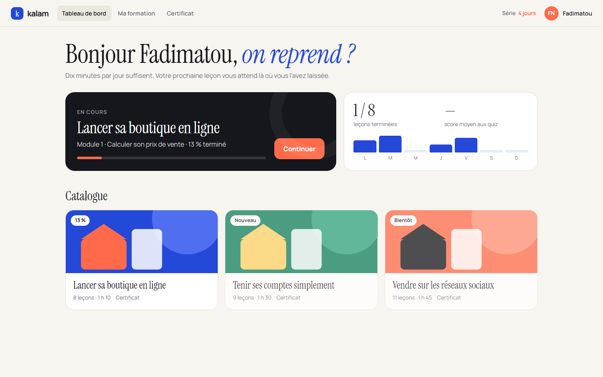
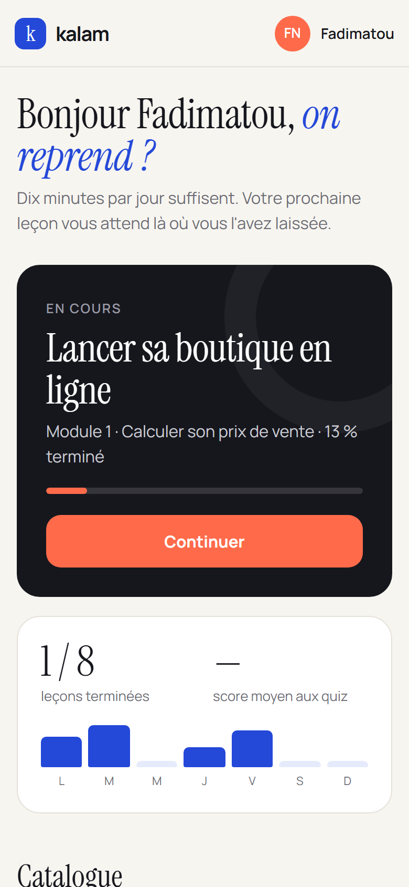

# Kalam

**Plateforme e-learning (LMS)** — Plateforme de formation en ligne pour entrepreneurs : tableau de bord de l'apprenant, parcours en modules, lecteur de leçons avec vidéo animée sous-titrée, exercices interactifs, quiz corrigés avec seuil de réussite, notes personnelles, déblocage progressif et certificat vérifiable.

**Démo en ligne : [https://lordlennyx.github.io/kalam-elearning/](https://lordlennyx.github.io/kalam-elearning/)**

Spot de présentation (30 s) : [media/spot-30s.mp4](https://lordlennyx.github.io/kalam-elearning/media/spot-30s.mp4)

## Ce que le projet montre

- Tableau de bord : reprise de la leçon en cours, progression, score moyen, activité de la semaine, catalogue
- Lecteur : sommaire par modules, leçons verrouillées jusqu'à validation de la précédente, vidéo animée avec sous-titres et barre de lecture
- Exercice interactif intégré (calculateur de prix de vente) et encadrés pédagogiques
- Quiz avec correction détaillée, seuil de 75 %, nouvelle tentative, résultats conservés
- Notes personnelles par leçon, progression enregistrée sur l'appareil
- Certificat A4 paysage personnalisable, code de vérification, export PDF

## Réalisation

- **Stack :** HTML, CSS, JavaScript natif, SVG animé
- **Typographies :** Instrument Serif, Manrope
- **Évolutions possibles :** comptes et back-office formateur, vraies vidéos (Vimeo, Bunny), paiement Mobile Money, SCORM

| Bureau | Mobile |
|---|---|
|  |  |

---

Client et contenus fictifs, créés pour la démonstration. Conception, design et développement : **Njundiyimun Béchard** — [github.com/LordLennyx](https://github.com/LordLennyx)
